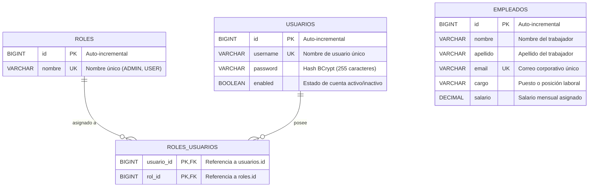

# INFORME TÉCNICO Y DOCUMENTACIÓN DE ENTREGA
# TALLER FINAL: DESARROLLO DE SOFTWARE SEGURO

---

## 1. PORTADA

**INSTITUCIÓN:** [Nombre de la Universidad / Institución Educativa]  
**FACULTAD:** Ingeniería de Sistemas y Computación  
**ASIGNATURA:** Desarrollo de Software Seguro  
**TEMA:** Implementación de API REST Segura con Spring Boot, Spring Security, BCrypt y MySQL  
**DOCENTE / TUTOR:** [Nombre del Tutor]  

**INTEGRANTES DEL GRUPO:**  
- [Nombre y Apellidos del Integrante 1] — Código: [XXXXXXXXXX]  
- [Nombre y Apellidos del Integrante 2] — Código: [XXXXXXXXXX]  
- [Nombre y Apellidos del Integrante 3] — Código: [XXXXXXXXXX]  

**FECHA DE ENTREGA:** Noviembre de 2026  
**CIUDAD:** [Ciudad, País]  

---

## 2. INTRODUCCIÓN

En la ingeniería de software actual, la seguridad no puede considerarse un complemento tardío en el ciclo de desarrollo, sino una disciplina transversal indispensable. Las arquitecturas basadas en APIs REST desacopladas son el estándar predominante en la industria, pero su exposición a redes abiertas las convierte en objetivos prioritarios de ataques si no cuentan con mecanismos rigurosos de autenticación, autorización y protección de datos.

El estándar internacional OWASP Top 10 destaca de manera constante el **Control de Acceso Roto (Broken Access Control)** y los **Fallos Criptográficos (Cryptographic Failures)** como dos de los riesgos más críticos para las aplicaciones web. Una falla en la validación de pertenencia o en la verificación de roles permite a usuarios maliciosos ejecutar operaciones destructivas (como borrar registros ajenos) o escalar privilegios para convertirse en administradores.

Este trabajo presenta la solución integral al Taller Final de la asignatura, mediante la construcción de un servicio web REST en Java 21 con el framework Spring Boot y su módulo Spring Security. Se implementa un modelo de Control de Acceso Basado en Roles (RBAC) con persistencia en MySQL, asegurando que las identidades y los permisos estén rigurosamente delimitados entre consultas públicas, operaciones operativas de usuario normal y facultades exclusivas de administración.

---

## 3. OBJETIVO GENERAL

Diseñar, implementar y validar un API REST robusta y segura mediante Spring Boot, Spring Security y MySQL para la gestión integral (CRUD) de la entidad Empleados y la administración controlada de Usuarios del sistema, garantizando la aplicación estricta de políticas de control de acceso por roles y el almacenamiento seguro de credenciales con BCrypt.

---

## 4. OBJETIVOS ESPECÍFICOS

1. Modelar una base de datos relacional normalizada en MySQL con las tablas `usuarios`, `roles`, `roles_usuarios` y `empleados`.
2. Implementar la autenticación de usuarios mediante `DaoAuthenticationProvider` y `UserDetailsService` dinámico con contraseñas cifradas en BCrypt.
3. Establecer reglas de autorización HTTP granulares en Spring Security:
   - Consulta pública de empleados (`GET`) accesible sin autenticación.
   - Creación (`POST`) y edición (`PUT`) de empleados permitida para roles `ADMIN` y `USER`.
   - Eliminación (`DELETE`) de empleados reservada exclusivamente para `ADMIN`, retornando HTTP `403 Forbidden` al rol `USER`.
4. Habilitar la creación y actualización de usuarios para el rol `USER`, incorporando defensas en la capa de servicios que impidan la modificación de cuentas ajenas, la alteración de cuentas de administradores y la autoasignación del rol `ADMIN`.
5. Prevenir la fuga de información sensible, garantizando que ninguna respuesta JSON exponga contraseñas ni hashes criptográficos.
6. Validar exhaustivamente todos los escenarios de seguridad mediante una colección automatizada de pruebas en Postman.

---

## 5. DESCRIPCIÓN DEL PROBLEMA Y SOLUCIÓN

### 5.1 El Problema
Las aplicaciones empresariales requieren centralizar información laboral (empleados) permitiendo que diferentes perfiles interactúen con ella de forma segura. El enunciado plantea las siguientes necesidades específicas:
- Los clientes o visitantes deben poder consultar la lista de empleados sin autenticación.
- El personal operativo ("Usuario normal") debe poder registrar y actualizar empleados, pero se le debe prohibir taxativamente la eliminación de registros para evitar pérdida accidental o maliciosa de datos.
- El usuario normal también debe tener la capacidad de dar de alta usuarios y actualizar su perfil, pero sin la posibilidad de vulnerar las cuentas de otros usuarios ni elevarse a sí mismo a administrador.
- El rol "Admin" debe contar con facultades plenas en el sistema.

### 5.2 La Solución Implementada
Se construyó un servicio web backend RESTful en Spring Boot estructurado en capas. La seguridad se desacopló mediante filtros HTTP de Spring Security y validaciones contextuales en los servicios de negocio (`@Transactional` y `SecurityContextHolder`). La solución garantiza:
- **Protección Perimetral:** Rutas protegidas que exigen credenciales válidas antes de alcanzar los controladores.
- **Protección de Datos:** Contraseñas hasheadas con salt dinámico mediante `BCryptPasswordEncoder` (fuerza 10).
- **Protección de Identidad y Roles:** El usuario `USER` únicamente puede actualizar su propia cuenta y cualquier intento de crear un usuario asignándole rol `ADMIN` es neutralizado por el backend forzando el rol `USER`.
- **Zero Exposure:** Uso de DTOs (`UsuarioResponseDto`) que excluyen cualquier metadato de contraseñas de las respuestas HTTP.

---

## 6. ARQUITECTURA DE LA APLICACIÓN

La aplicación adopta una arquitectura desacoplada por capas:

```
[ Cliente HTTP / Postman ]
          │ (HTTP Basic Auth / JSON)
          ▼
[ Capa de Filtros: Spring Security (SecurityFilterChain) ]
          │ (Autenticación y Autorización HTTP)
          ▼
[ Capa de Controladores (REST Controllers) ]
    ├── EmpleadoController (/api/empleados)
    └── UsuarioController  (/api/usuarios)
          │ (DTOs / Validación @Valid)
          ▼
[ Capa de Servicios de Negocio (Services) ]
    ├── EmpleadoService (Lógica de empleados y reglas de duplicados)
    └── UsuarioService  (Lógica de usuarios, BCrypt y control anti-escalamiento)
          │
          ▼
[ Capa de Acceso a Datos (Spring Data JPA Repositories) ]
    ├── EmpleadoRepository
    ├── UsuarioRepository
    └── RolRepository
          │ (Hibernate ORM / Dialecto MySQL)
          ▼
[ Base de Datos Relacional: MySQL Server ]
    (usuarios, roles, roles_usuarios, empleados)
```

---

## 7. TECNOLOGÍAS UTILIZADAS

| Componente | Tecnología | Versión | Propósito |
| :--- | :--- | :--- | :--- |
| **Lenguaje** | Java (JDK) | 21 LTS | Plataforma principal de desarrollo moderno |
| **Framework Base** | Spring Boot | 4.x / 3.4+ | Contenedor de inversión de control, inyección de dependencias y autoconfiguración |
| **Seguridad** | Spring Security | 6.x+ | Filtros de autenticación, control de sesiones, protección CSRF/CORS y RBAC |
| **Cifrado** | BCrypt | Algoritmo estándar | Función hash adaptativa unidireccional con sal incorporada para contraseñas |
| **Persistencia** | Spring Data JPA / Hibernate | 7.x | Mapeo objeto-relacional (ORM) y abstracción de repositorios |
| **Base de Datos** | MySQL Server / H2 (modo MySQL) | 8.x / 2.x | Motor relacional para persistencia de datos |
| **Gestor de Construcción**| Apache Maven | 3.10+ | Gestión de dependencias, compilación y ciclo de vida de pruebas |
| **Cliente de Pruebas** | Postman | 11.x+ | Ejecución y automatización de pruebas funcionales y de seguridad |

---

## 8. EXPLICACIÓN DE CADA PAQUETE, CLASE E INTERFAZ

### 8.1 Paquete `com.taller.seguridad.model`
- **`Rol.java`:** Entidad JPA que representa la tabla `roles`. Almacena el identificador autoincremental y el nombre único del rol (`ADMIN`, `USER`).
- **`Usuario.java`:** Entidad JPA que mapea la tabla `usuarios`. Contiene las propiedades `username`, `password` (anotada con `@JsonProperty(access = JsonProperty.Access.WRITE_ONLY)` para evitar deserialización accidental), `enabled` y la relación `@ManyToMany` con roles.
- **`Empleado.java`:** Entidad JPA que mapea la tabla `empleados`. Implementa anotaciones de Bean Validation (`@NotBlank`, `@Email`, `@NotNull`, `@DecimalMin`).

### 8.2 Paquete `com.taller.seguridad.dto`
- **`UsuarioResponseDto.java`:** Proyección de salida que contiene exclusivamente `id`, `username`, `enabled` y la lista de nombres de `roles`.
- **`UsuarioRequestDto.java`:** DTO de entrada para dar de alta usuarios con validaciones de longitud mínima de clave (mínimo 6 caracteres).
- **`UsuarioUpdateDto.java`:** DTO de entrada para operaciones `PUT /api/usuarios/{id}` con campos opcionales para contraseña, username y estado.

### 8.3 Paquete `com.taller.seguridad.repository`
- **`RolRepository.java`:** Interfaz `JpaRepository<Rol, Long>` con búsqueda por nombre `findByNombre(String nombre)`.
- **`UsuarioRepository.java`:** Interfaz `JpaRepository<Usuario, Long>` con `findByUsername(String username)` y `existsByUsername(String username)`.
- **`EmpleadoRepository.java`:** Interfaz `JpaRepository<Empleado, Long>` con `existsByEmail(String email)` para prevenir correos duplicados.

### 8.4 Paquete `com.taller.seguridad.security`
- **`CustomUserDetailsService.java`:** Implementación de la interfaz `UserDetailsService` de Spring Security. Carga el usuario desde la base de datos por su `username` y transforma los roles a objetos `SimpleGrantedAuthority` con el prefijo obligatorio `ROLE_` (ej. `ROLE_ADMIN`, `ROLE_USER`).

### 8.5 Paquete `com.taller.seguridad.service`
- **`EmpleadoService.java`:** Coordina las operaciones de negocio de empleados. Valida que no se dupliquen correos al registrar o editar y verifica la existencia de registros antes de proceder a la eliminación física.
- **`UsuarioService.java`:** Concentra la lógica de seguridad avanzada:
  - Codifica las contraseñas entrantes con `passwordEncoder.encode()`.
  - En la creación: si el usuario autenticado es `USER`, ignora cualquier solicitud de rol administrativo y asigna únicamente `ROLE_USER`.
  - En la actualización: comprueba mediante `SecurityContextHolder` que si el usuario no es `ADMIN`, únicamente pueda editar la cuenta que coincida con su propio nombre de usuario autenticado; prohíbe terminantemente la edición de cuentas de administradores y rechaza cualquier intento de autoasignarse roles superiores con HTTP 403.

### 8.6 Paquete `com.taller.seguridad.controller`
- **`EmpleadoController.java`:** Expone los endpoints REST bajo `/api/empleados` para listar, consultar por ID, crear, modificar y eliminar.
- **`UsuarioController.java`:** Expone endpoints REST bajo `/api/usuarios` para listar, crear (`POST`) y modificar (`PUT`).

### 8.7 Paquete `com.taller.seguridad.config`
- **`SecurityConfig.java`:** Clase de configuración con `@EnableWebSecurity`. Configura el bean `PasswordEncoder` (BCrypt), el bean `DaoAuthenticationProvider`, CORS abierto para clientes y el `SecurityFilterChain` con las directivas HTTP.
- **`DataLoader.java`:** Implementa `CommandLineRunner` para sembrar de forma idempotente en la base de datos los roles `ADMIN` y `USER`, las cuentas de prueba iniciales (`admin`/`admin123` y `user`/`user123`) y los empleados base, sin duplicar registros en reinicios.

---

## 9. EXPLICACIÓN DE LAS CUATRO TABLAS Y SUS RELACIONES

El modelo relacional está normalizado en Tercera Forma Normal (3NF):



1. **`roles`:** Almacena los tipos de perfiles del sistema. Su clave primaria es `id` y `nombre` cuenta con una restricción de unicidad (`UNIQUE`).
2. **`usuarios`:** Almacena las identidades con acceso al sistema. El campo `password` tiene longitud de 255 caracteres para alojar de forma segura el hash BCrypt con su respectivo salt.
3. **`roles_usuarios`:** Tabla asociativa pura para materializar la relación muchos a muchos entre usuarios y roles. Su clave primaria es compuesta `(usuario_id, rol_id)` y cuenta con restricciones de clave foránea con borrado en cascada (`ON DELETE CASCADE`).
4. **`empleados`:** Tabla que almacena los datos de negocio objeto del CRUD. Mantiene la integridad mediante `id` como clave primaria y restricción `UNIQUE` sobre el campo `email`.

---

## 10. FUNCIONAMIENTO DE SPRING SECURITY

Spring Security opera como una cadena de filtros de servlets (`SecurityFilterChain`) que intercepta cada solicitud entrante antes de que llegue a los controladores de Spring MVC:

1. **Intercepción:** El filtro `BasicAuthenticationFilter` intercepta la cabecera HTTP `Authorization: Basic <base64>`.
2. **Extracción y Decodificación:** Extrae las credenciales en texto claro (ej. `user:user123`).
3. **Autenticación (DaoAuthenticationProvider):** Invoca a `CustomUserDetailsService.loadUserByUsername()`, el cual consulta la tabla `usuarios` en MySQL junto con sus roles en `roles_usuarios`.
4. **Validación Criptográfica:** El `PasswordEncoder` ejecuta `matches(rawPassword, encodedPassword)` verificando la sal y el hash BCrypt sin revertir la clave.
5. **Establecimiento del Contexto:** Si la clave coincide, crea un token `UsernamePasswordAuthenticationToken` y lo almacena en el `SecurityContextHolder`.
6. **Autorización (AuthorizationFilter):** Evalúa la ruta y el método HTTP contra las directivas declaradas en `SecurityConfig`. Si un usuario con rol `USER` intenta acceder a una ruta reservada para `ADMIN` (como `DELETE /api/empleados/{id}`), el filtro interrumpe inmediatamente el flujo y retorna **HTTP 403 Forbidden**.

---

## 11. EXPLICACIÓN DE LOS ROLES ADMIN Y USER

- **Rol `ADMIN` (Administrador del Sistema):**
  - Perfil con control absoluto del sistema.
  - Puede consultar, crear, modificar y eliminar cualquier registro de la tabla `empleados`.
  - Puede consultar todos los usuarios, crear nuevos usuarios con cualquier rol asignado y actualizar cualquier cuenta (incluyendo cambiar estados de habilitación y reasignar roles).
- **Rol `USER` (Usuario Normal):**
  - Perfil operativo de uso cotidiano.
  - Puede consultar la lista de empleados y consultar por ID.
  - Puede registrar nuevos empleados (`POST`) y editar empleados existentes (`PUT`).
  - **Restricción estricta:** Tiene prohibida la eliminación de empleados (`DELETE`). Cualquier intento genera un rechazo HTTP 403 Forbidden.
  - Puede registrar nuevos usuarios del sistema (el backend forzará que el rol asignado sea exclusivamente `USER`).
  - Únicamente puede actualizar su propia cuenta de usuario. No puede alterar cuentas ajenas ni cuentas de administradores.

---

## 12. MATRIZ DE PERMISOS

| Recurso / Endpoint | Método | Acceso Público (Sin Auth) | Rol USER (Usuario Normal) | Rol ADMIN (Administrador) |
| :--- | :---: | :---: | :---: | :---: |
| `/api/empleados` | `GET` | ✅ Permitido (`200 OK`) | ✅ Permitido (`200 OK`) | ✅ Permitido (`200 OK`) |
| `/api/empleados/{id}` | `GET` | ✅ Permitido (`200 OK`) | ✅ Permitido (`200 OK`) | ✅ Permitido (`200 OK`) |
| `/api/empleados` | `POST` | ❌ Denegado (`401`) | ✅ Permitido (`201 Created`) | ✅ Permitido (`201 Created`) |
| `/api/empleados/{id}` | `PUT` | ❌ Denegado (`401`) | ✅ Permitido (`200 OK`) | ✅ Permitido (`200 OK`) |
| `/api/empleados/{id}` | `DELETE`| ❌ Denegado (`401`) | 🚫 **PROHIBIDO (`403 Forbidden`)** | ✅ **Permitido (`204 No Content`)** |
| `/api/usuarios` | `GET` | ❌ Denegado (`401`) | ✅ Permitido (`200 OK`) | ✅ Permitido (`200 OK`) |
| `/api/usuarios` | `POST` | ❌ Denegado (`401`) | ✅ Permitido (Forzado a `USER`) | ✅ Permitido (Asigna cualquier rol) |
| `/api/usuarios/{id}` | `PUT` | ❌ Denegado (`401`) | ✅ Solo su propia cuenta (`200`) | ✅ Cualquier cuenta (`200 OK`) |
| `/api/usuarios/1` (admin) | `PUT` | ❌ Denegado (`401`) | 🚫 **PROHIBIDO (`403 Forbidden`)** | ✅ Permitido (`200 OK`) |

---

## 13. EXPLICACIÓN DE LAS PRUEBAS REALIZADAS EN POSTMAN

La colección `Postman_Collection_Taller_Seguridad.json` incluye 13 solicitudes con scripts de prueba (`Tests`) automatizados:

1. **`01. Consultar empleados sin autenticación`:** Realiza un `GET /api/empleados` anónimo. Verifica código `200 OK` y que el cuerpo sea una lista JSON.
2. **`02. Intentar crear empleado sin autenticación`:** Realiza un `POST /api/empleados` anónimo. Verifica el rechazo perimetral con `401 Unauthorized`.
3. **`03. Iniciar sesión como ADMIN`:** Realiza un `GET /api/usuarios` con credenciales `admin:admin123`. Valida código `200 OK` y comprueba que la respuesta no exponga contraseñas.
4. **`04. Crear empleado como ADMIN`:** Realiza un `POST /api/empleados` con datos de un nuevo empleado. Verifica `201 Created` y captura el identificador generado en las variables de colección.
5. **`05. Editar empleado como ADMIN`:** Realiza un `PUT /api/empleados/1` actualizando cargo y salario. Verifica código `200 OK` y confirmación de los datos cambiados.
6. **`06. Eliminar empleado como ADMIN`:** Realiza un `DELETE /api/empleados/3`. Verifica respuesta exitosa `204 No Content`.
7. **`07. Iniciar sesión como USER`:** Verifica autenticación con credenciales `user:user123` recibiendo `200 OK`.
8. **`08. Crear empleado como USER`:** Realiza un `POST /api/empleados` autenticado como usuario normal. Valida que el usuario normal tiene permiso de inserción (`201 Created`).
9. **`09. Editar empleado como USER`:** Realiza un `PUT /api/empleados/2` autenticado como usuario normal. Valida permiso de actualización (`200 OK`).
10. **`10. Intentar eliminar empleado como USER`:** Realiza un `DELETE /api/empleados/1` como usuario normal. **El script valida que el servidor responde con `403 Forbidden`**, certificando la restricción de privilegios destructivos.
11. **`11. Crear usuario como USER`:** Realiza un `POST /api/usuarios` enviando maliciosamente `"roles": ["ADMIN"]`. El script valida que el servidor retorne `201 Created` pero con roles conteniendo únicamente `USER`.
12. **`12. Editar usuario como USER`:** Realiza un `PUT /api/usuarios/2` (su propia cuenta) actualizando su contraseña a `nuevaClaveUser123`. El script valida `200 OK` y actualiza dinámicamente la variable de colección `normal_pass`.
13. **`13. Intentar editar cuenta ADMIN como USER`:** Realiza un `PUT /api/usuarios/1` autenticado con las nuevas credenciales de `user`. El script valida que el servidor rechaza la modificación con **`403 Forbidden`**.

---

## 14. EVIDENCIAS Y CAPTURAS DE PANTALLA DE LAS PRUEBAS

> *Instrucción para el estudiante: Inserta en cada recuadro la captura de pantalla correspondiente obtenida al ejecutar la colección de Postman y la terminal.*

### Captura 1: Inicio exitoso de la aplicación Spring Boot en la terminal
```
+--------------------------------------------------------------------------+
|                                                                          |
|       [ PEGAR AQUÍ CAPTURA DE PANTALLA DE LA CONSOLA MOSTRANDO:           |
|         "Started EmpleadosSeguridadApplication in X.XXX seconds" ]        |
|                                                                          |
+--------------------------------------------------------------------------+
```

### Captura 2: Prueba 01 - Consulta pública de empleados (200 OK)
```
+--------------------------------------------------------------------------+
|                                                                          |
|       [ PEGAR AQUÍ CAPTURA DE POSTMAN MOSTRANDO GET /api/empleados       |
|         SIN AUTENTICACIÓN RETORNANDO CÓDIGO 200 OK Y EL JSON ]            |
|                                                                          |
+--------------------------------------------------------------------------+
```

### Captura 3: Prueba 02 - Intento de creación sin autenticación (401 Unauthorized)
```
+--------------------------------------------------------------------------+
|                                                                          |
|       [ PEGAR AQUÍ CAPTURA DE POSTMAN MOSTRANDO POST /api/empleados      |
|         SIN AUTENTICACIÓN RETORNANDO CÓDIGO 401 UNAUTHORIZED ]           |
|                                                                          |
+--------------------------------------------------------------------------+
```

### Captura 4: Prueba 06 - Eliminación exitosa de empleado por ADMIN (204 No Content)
```
+--------------------------------------------------------------------------+
|                                                                          |
|       [ PEGAR AQUÍ CAPTURA DE POSTMAN MOSTRANDO DELETE /api/empleados/3  |
|         CON AUTH BASIC ADMIN RETORNANDO 204 NO CONTENT ]                 |
|                                                                          |
+--------------------------------------------------------------------------+
```

### Captura 5: Prueba 10 - Intento de eliminación por USER denegada (403 Forbidden)
```
+--------------------------------------------------------------------------+
|                                                                          |
|       [ PEGAR AQUÍ CAPTURA DE POSTMAN MOSTRANDO DELETE /api/empleados/1  |
|         CON AUTH BASIC USER RETORNANDO CÓDIGO 403 FORBIDDEN ]            |
|                                                                          |
+--------------------------------------------------------------------------+
```

### Captura 6: Prueba 13 - Intento de modificación de cuenta ADMIN por USER (403 Forbidden)
```
+--------------------------------------------------------------------------+
|                                                                          |
|       [ PEGAR AQUÍ CAPTURA DE POSTMAN MOSTRANDO PUT /api/usuarios/1      |
|         CON AUTH BASIC USER RETORNANDO CÓDIGO 403 FORBIDDEN ]            |
|                                                                          |
+--------------------------------------------------------------------------+
```

---

## 15. CONCLUSIONES

1. **Eficacia del Principio de Menor Privilegio (POLP):** La segregación estricta entre operaciones destructivas (`DELETE`) y de mantenimiento (`POST`/`PUT`) protege la información del negocio frente a errores u operadores maliciosos, cumpliendo con las mejores prácticas de desarrollo seguro.
2. **Defensa en Profundidad:** Se demostró que la seguridad no debe recaer únicamente en la capa de transporte o en la URL, sino que debe complementarse con validaciones a nivel de servicio para inspeccionar la identidad del usuario y proteger las entidades críticas (cuentas administrativas).
3. **Seguridad Criptográfica sin Exposición:** La implementación de BCrypt con costo computacional previene ataques de fuerza bruta y diccionarios, mientras que la separación estricta mediante DTOs garantiza que los hashes nunca viajen en las respuestas hacia los clientes.
4. **Diseño RESTful Estándar:** El proyecto entrega códigos de estado HTTP semánticos y apropiados (`200 OK`, `201 Created`, `204 No Content`, `401 Unauthorized`, `403 Forbidden`, `404 Not Found`), permitiendo una integración transparente con cualquier cliente web, móvil o de pruebas.

---

## 16. REFERENCIAS BIBLIOGRÁFICAS (FORMATO APA 7)

- Open Web Application Security Project. (2021). *OWASP Top 10:2021 - The Ten Most Critical Web Application Security Risks*. OWASP Foundation. https://owasp.org/Top10/
- Spilca, L. (2021). *Spring Security in Action*. Manning Publications.
- VMware, Inc. (2026). *Spring Boot Reference Documentation*. Spring Documentation. https://docs.spring.io/spring-boot/docs/current/reference/html/
- VMware, Inc. (2026). *Spring Security Architecture and Reference*. Spring Documentation. https://docs.spring.io/spring-security/reference/
- Walls, C. (2022). *Spring in Action* (6th ed.). Manning Publications.

